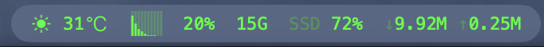
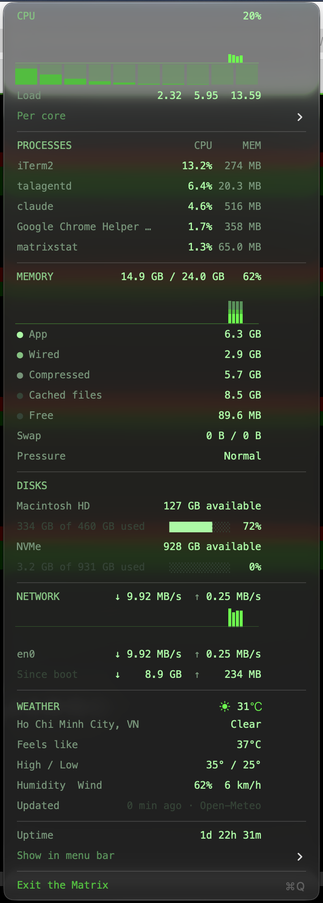

# matrixstat

**iStat-style system monitor for the macOS menu bar, in Matrix green.**

One status item shows the weather, a bar per CPU core, then `cpu%  mem  SSD%  ↓rx ↑tx`.
The dropdown is laid out like iStat Menus: a header with the headline value, a two-minute history graph, then aligned rows.
Everything is phosphor green (`#00FF41`) in Menlo on a dark menu; hot values turn red.
Rust, about 3 MB, no Dock icon, no elevated privileges; the only network use is the weather lookup.

<p align="center">
  <br><br>
  
</p>

## Install

Download `matrixstat.app` from [Releases](https://github.com/huytz/matrixstat/releases)
(Apple Silicon and Intel), drop it in `~/Applications`, open it. Or build from source:

```sh
cargo install --git https://github.com/huytz/matrixstat   # bare binary on $PATH
# or
git clone https://github.com/huytz/matrixstat && cd matrixstat
scripts/install.sh --launchd     # ~/Applications/matrixstat.app + start at login
```

Needs macOS 14+ and, to build, Rust 1.95+.

## What it shows

| Section | Rows |
|---|---|
| Menu bar | weather icon + temperature with ℃ symbol (first), per-core bars, CPU %, memory used, root disk used %, network ↓↑ rate; each part can be hidden |
| CPU | total %, 2-minute history, per-core strip, load averages, `Per core` submenu with a gauge per core |
| Processes | top 5 by CPU (percent of one core, as in Activity Monitor) with resident memory |
| Memory | used / total %, stacked history, App · Wired · Compressed · Cached files · Free, swap, memory pressure |
| Disks | every user-visible volume: available space, used gauge |
| Network | total ↓/↑ rate in MB/s, mirrored 2-minute history (auto-scaled), per-interface rates, bytes since boot; loopback, VPN `utun*`, AWDL and bridges are skipped so tunnelled traffic is not counted twice |
| Weather | condition icon and temperature, place, feels like, today's high/low, humidity, wind; location from public IP, refreshed every 15 min |
| System | uptime |

Values at or above 90 % and memory pressure Warning/Critical are red. Refresh is every 2 s
(weather every 15 min, retried after 1 min on failure).

## Menu bar toggles

`Show in menu bar ›` has a check item for **Core bars**, **CPU %**, **Memory used** and
**Disk used**, **Network ↓↑** and **Weather**. Changes apply at once and are saved to
`~/Library/Application Support/matrixstat/config` (`key=true` lines). With everything unticked
CPU % stays on so the item never goes blank.

If macOS collapses status items behind `»`, the bar is full: ⌘-drag the item to the right, or
untick parts to make it narrower.

## Options

| Environment | Values | Effect |
|---|---|---|
| `MATRIXSTAT_TITLE` | `cpu,mem,disk,net,weather` (default), any subset, `none` | initial text parts; ignored once the config file exists |
| `MATRIXSTAT_LOCATION` | `lat,lon`, e.g. `10.78,106.70` | weather for this point instead of the IP location (useful behind a VPN) |
| `MATRIXSTAT_DEMO` | `1` | opens the dropdown on the 3rd tick, for screenshots |

`matrixstat --once` prints one snapshot as text and exits (no GUI), handy for scripts and CI.

## How it works

- [`sysinfo`](https://crates.io/crates/sysinfo) for CPU, processes, disks, network, swap;
  Mach `host_statistics64` for the Activity Monitor memory split and
  `kern.memorystatus_vm_pressure_level` for pressure.
- [`tray-icon`](https://crates.io/crates/tray-icon) + [`tao`](https://crates.io/crates/tao)
  for the status item and run loop. Rows are `NSAttributedString`s (Menlo, four green tones);
  graphs are RGBA canvases rendered in Rust, PNG-encoded and mounted as `NSImageView`s through
  `NSMenuItem.view`. The menu is forced to the dark appearance.
- Weather: [ipinfo.io](https://ipinfo.io) for an approximate location from the public IP, then
  [Open-Meteo](https://open-meteo.com) (free, no API key) on a background thread via `ureq`.
  Condition icon and ℃ are SF Symbols tinted green, mounted as `NSTextAttachment`s; the core
  bars are an inline attachment too, so weather can sit before them in one status item.
- Info rows are disabled menu items: no hover highlight, no click action.

## Limits

- macOS only (AppKit). Tested on macOS 26/27, Apple Silicon.
- Weather location is IP-based (city level); a VPN shows its exit city unless `MATRIXSTAT_LOCATION`
  is set. Temperatures are °C only.
- Disk "available" includes purgeable space (what Finder shows), so it is larger than `df`.
- No temperatures or fans yet; the history is 60 samples and not persisted.

[CONTRIBUTING](CONTRIBUTING.md) · [SECURITY](SECURITY.md) · [CHANGELOG](CHANGELOG.md) · [MIT](LICENSE)
